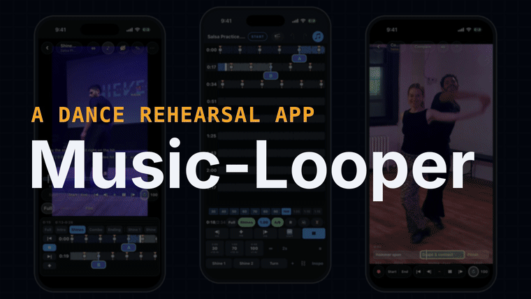

# Music-Looper

*A dance rehearsal mobile app for iOS and Android*

Personal project by [Luis Escobar](https://github.com/Escobar-Luis) · June 2026 to present

 

**[Watch the 1-minute demo](https://escobar-luis.github.io/music-looper-showcase/)**

 

## What I built

- Cut drill setup from several minutes to two taps with saved song sections and automatic speed ramps that speed up each rep, with a pause between reps so dancers never stop the song
- Filed teacher clips and past takes under each song section, so a long press shows every reference for that part, and added looped, slowed video and side-by-side compare to choreograph faster

## About this repo

The source is private. This page is the public write-up of what Music-Looper does. Happy to walk an interviewer through the code live.

 

[Portfolio](https://luisalfredoescobar.netlify.app/) · [LinkedIn](https://www.linkedin.com/in/luisalfredoescobar/) · [X](https://x.com/luisalfescobar) · [GitHub](https://github.com/Escobar-Luis)

